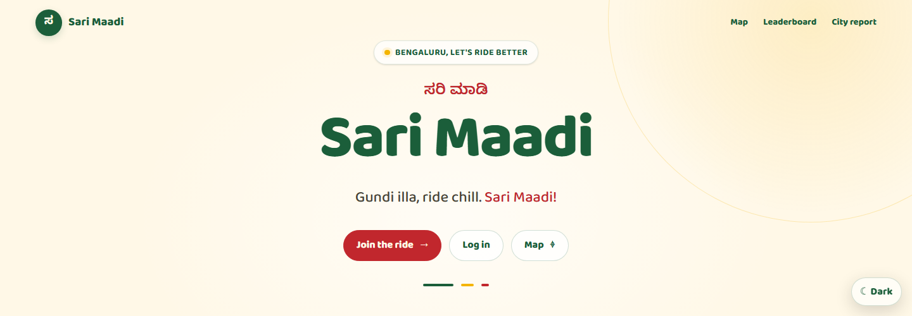
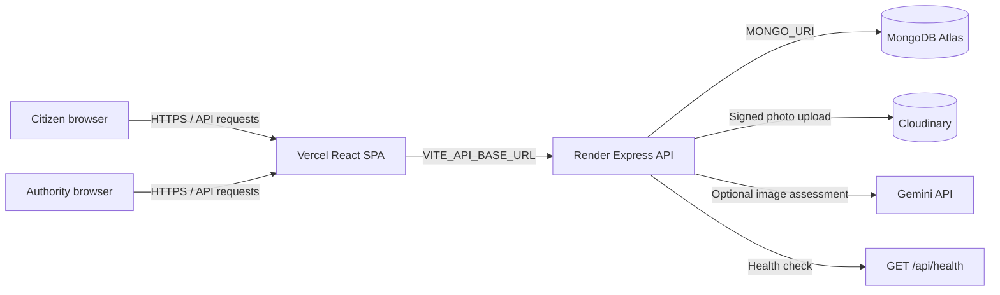
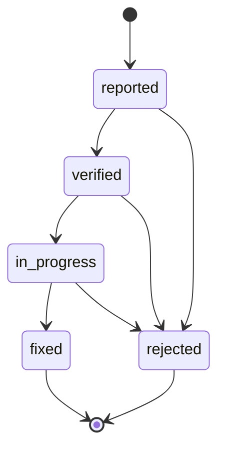

# Sari Maadi

[](https://github.com/srushtisp09/Saari-Maadi/actions/workflows/ci.yml)
[](https://github.com/srushtisp09/Saari-Maadi/actions)

**A community-powered Bengaluru pothole tracker that turns a road photo into an accountable repair workflow.**

> **Live demo:** [Open the web app](https://YOUR-VERCEL-DOMAIN.vercel.app) · [API health](https://YOUR-RENDER-SERVICE.onrender.com/api/health) · [Interactive API docs](https://YOUR-RENDER-SERVICE.onrender.com/api/docs)
> Replace these three links with the domains shown in your Vercel and Render dashboards after deployment.



## The problem

Road damage is easy to spot but hard to track: reports are scattered, residents
cannot see whether an issue was reviewed, and authorities have no shared,
prioritized queue. Sari Maadi gives citizens a way to report and follow a
pothole, while city staff can verify it, coordinate repair, and close the loop.

## Features by phase

- **Phase 1 — Report and discover:** responsive landing experience, citizen
  registration/login, photo-and-location reports, AI-assisted pothole checks,
  map browsing, and nearby duplicate warnings.
- **Phase 2A — Community engagement:** upvotes, points, badges, contributor
  leaderboard, and a public city report card.
- **Phase 2B — Authority workflow:** authority/admin roles, urgency-ranked
  review queue, status history, notifications, service-level tracking, and a
  one-time repair reward.
- **Phase 2C — Insights:** authority analytics, hotspot clusters, report trends,
  SLA metrics, contributor insights, and paginated profiles.
- **Phase 2D — Security and quality:** validated requests, role checks,
  rate-limits, secure headers, refresh-token rotation, structured redacted
  logs, OpenAPI/Swagger, health checks, offline support, and CI/E2E tests.
- **Phase 2E — Production readiness:** Cloudinary image storage, Render/Vercel
  deployment configuration, Atlas-ready production settings, optional demo
  data, and a cold-start notice.

## Technology

| Area | Stack |
| --- | --- |
| Web | React, Vite, Tailwind CSS, React Router, Leaflet |
| API | Node.js 22, Express 5, Mongoose |
| Data | MongoDB Atlas; isolated in-memory MongoDB for tests |
| Media | Cloudinary in production; local files only in development |
| AI | Gemini multimodal image assessment (optional) |
| Quality | Oxlint, Jest, Supertest, Playwright, GitHub Actions |
| Hosting | Vercel (SPA), Render (web service), MongoDB Atlas, Cloudinary |

## Architecture



### Report status flow



## API

Interactive docs: `/api/docs` · OpenAPI JSON: `/api/docs/openapi.json` ·
Health: `/api/health`.

The API includes authentication, reports, nearby search, report status,
notifications, profiles, analytics, leaderboard, city summary, and stats.
Production documentation URLs are linked above once the Render service is
deployed.

## Local setup

Requirements: Node.js 22+, npm, and a MongoDB URI for persistent local data.
Without `MONGO_URI`, development uses temporary `mongodb-memory-server` data.

```powershell
npm ci
npm --prefix server ci
Copy-Item server\.env.example server\.env
```

Set `JWT_SECRET` in `server/.env` to a random value of at least 32 characters.
Set `MONGO_URI` for persistence; set all three Cloudinary variables to use
Cloudinary locally, or leave them blank to use the development-only
`server/uploads/` fallback. The upload limit remains 5 MB for JPEG, PNG, or
WebP. Gemini is optional. The Vite app runs at `http://localhost:5173` and
proxies `/api` to `http://localhost:5000`.

Start both apps:

```powershell
npm run dev
```

For frontend environment overrides, copy [client/.env.example](client/.env.example)
to the Vite project root as `.env.local`; leave `VITE_API_BASE_URL` empty for
the local proxy. For local demo accounts, set `DEMO_MODE=true` and provide
`DEMO_AUTHORITY_PASSWORD` and `DEMO_CITIZEN_PASSWORD` in `server/.env`; matching
`VITE_DEMO_*` values are needed if you want the login page to display them.

## Environment variables

| Variable | App | Required | Purpose |
| --- | --- | --- | --- |
| `MONGO_URI` | Render API | Yes in production | Atlas connection string; blank locally uses temporary memory DB |
| `JWT_SECRET` | Render API | Always | Random signing secret, at least 32 characters |
| `JWT_REFRESH_SECRET` | Render API | No | Optional separate refresh-token signing key |
| `CORS_ORIGINS` | Render API | Yes in production | Comma-separated exact browser origins, no paths |
| `CLOUDINARY_CLOUD_NAME` | Render API | Yes in production | Cloudinary account cloud name |
| `CLOUDINARY_API_KEY` | Render API | Yes in production | Cloudinary API key |
| `CLOUDINARY_API_SECRET` | Render API | Yes in production | Cloudinary API secret; keep private |
| `DEMO_MODE` | Render API | No; defaults false | Seeds demo authority, citizen, and sample reports when true |
| `DEMO_AUTHORITY_PASSWORD` | Render API | When demo enabled | Environment-provided demo authority password |
| `DEMO_CITIZEN_PASSWORD` | Render API | When demo enabled | Environment-provided demo citizen password |
| `GEMINI_API_KEY` | Render API | No | Enables image assessment and duplicate-photo comparison |
| `GEMINI_MODEL` | Render API | No | Gemini model; defaults to `gemini-3.5-flash-lite` |
| `PORT` | Render API | Render-managed | HTTP port supplied by the Render service |
| `VITE_API_BASE_URL` | Vercel web | Yes in production | Render API origin, e.g. `https://saari-maadi-api.onrender.com` |
| `VITE_DEMO_MODE` | Vercel web | No; defaults false | Show login demo panel when server demo mode is enabled |
| `VITE_DEMO_AUTHORITY_EMAIL` | Vercel web | When demo panel enabled | Public demo authority login email |
| `VITE_DEMO_AUTHORITY_PASSWORD` | Vercel web | When demo panel enabled | Public demo authority password; deliberately visible |
| `VITE_DEMO_CITIZEN_EMAIL` | Vercel web | When demo panel enabled | Public demo citizen login email |
| `VITE_DEMO_CITIZEN_PASSWORD` | Vercel web | When demo panel enabled | Public demo citizen password; deliberately visible |

**Do not put server secrets in Vercel variables.** `VITE_*` values are included
in the public frontend build; only the intentionally public demo credentials
belong there.

## What I learned and key engineering decisions

- **Duplicate detection:** reports within 30 metres are candidates, not
  automatic rejections. Gemini compares the photos; if it is unavailable, the
  user gets a clear fallback warning and can confirm a genuinely different
  pothole. This balances duplicate reduction with resident agency.
- **Idempotent rewards:** reward events use stable event keys and a uniqueness
  guarantee. Retried requests cannot award the same points twice, and removing
  an upvote does not reverse points already earned.
- **Status transition rules:** the API enforces a finite transition map rather
  than trusting the UI. Terminal states cannot be reopened through the normal
  workflow, status history records the actor, and repair bonuses are awarded
  once.
- **Role-based access:** role checks are enforced at protected API routes.
  Citizens can report and participate; only authorities/admins can change
  workflow status or access authority analytics. Hiding a link in the UI is
  not treated as authorization.

## Tests and builds

Backend Jest/Supertest tests currently report **76.30% statement coverage**;
CI also runs Playwright flows and accessibility checks. The workflow is shown
by the CI badge above.

```powershell
npm run lint
npm test
npm run test:e2e
npm run build
```

`npm run build` creates the Vite production bundle and syntax-checks the
server's JavaScript entry points/modules. The API is a Node runtime service
and does not need a separate compiled bundle.

## Screenshots to capture

Store portfolio screenshots in [`docs/screenshots/`](docs/screenshots/). Capture
desktop images at a consistent viewport and redact any personal data:

1. `hero.png` — landing page with the product name, pitch, and report/map call
   to action (used above).
2. `citizen-map.png` — map with reports, status/severity markers, and filters.
3. `report-detail.png` — a report with location, status timeline, and upvotes.
4. `authority-queue.png` — priority-ranked queue and an allowed status action.
5. `analytics.png` — status trends, SLA summary, and hotspots.
6. `demo-login.png` — login page displaying the demo account panel (use only
   intentionally public demo credentials).

## Deployment

Follow the exact provider setup and copy/paste checklist in
[Phase 2E deployment notes](docs/PHASE-2E-deployment.md).
